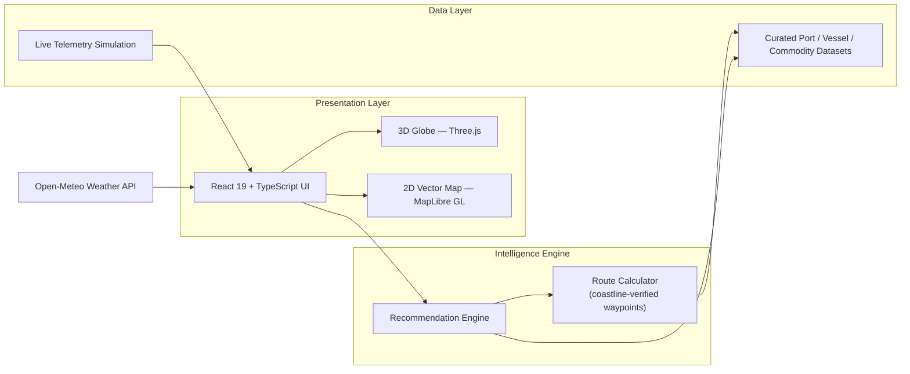

# 🚢 MARLIN — Maritime Intelligence for Dry-Bulk Chartering

**Real-time route, port, and chartering intelligence for India's dry-bulk import trade.**

MARLIN fuses live AIS-style fleet telemetry, port congestion data, real weather, and
coastline-accurate ocean routing into a single decision surface for chartering coal, iron
ore, bauxite, fertilizers, and grain into Indian ports — replacing the spreadsheets and
stale PDFs a chartering desk normally juggles.

Built for **Smart India Hackathon**.

---

## ✨ What it does

- **3D globe & 2D vector map** — an interactive Three.js globe (real NASA night-lights
  texture, cloud layer, normal/specular maps, procedural starfield) alongside a MapLibre GL
  vector map with live vessel, port, and chokepoint markers.
- **22+ ports across 4 continents** — India's east *and* west coasts (Paradip, Vizag,
  Gangavaram, Haldia, Dhamra, Gopalpur, Mundra, Kandla, Mormugao), Australia, Indonesia,
  South Africa, Mozambique, Morocco, Saudi Arabia, Oman, and Jordan.
- **Coastline-verified routing** — every corridor is checked against real Natural Earth
  coastline data so vessel routes thread actual straits (Malacca, Hormuz, Suez, Bab-el-Mandeb,
  Gibraltar, the Nine Degree Channel) instead of cutting a straight line across land.
- **Deterministic recommendation engine** — WAIT vs. EXECUTE chartering guidance with a
  recommended vessel class, contract structure, and projected $ savings, all derived
  transparently from the route, cargo, and market inputs — never a black box.
- **19 commodities** — the full dry-bulk basket India imports: thermal & coking coal, iron
  ore, bauxite, grain, DAP/rock phosphate, urea, MOP potash, pulses, steel scrap, pet coke,
  sulphur, and more.
- **Live weather** — real marine forecasts via the free, keyless [Open-Meteo](https://open-meteo.com) API.
- **Exportable chartering memos** — one click to a print-ready PDF, CSV, or JSON dossier.

## 🏗️ Architecture



**User workflow:** configure cargo & route → compute a live, coastline-safe distance and
weather picture → get a WAIT/EXECUTE recommendation with vessel fit and savings → export the
chartering memo.

## 🧰 Tech stack

| Layer | Technology |
|---|---|
| UI | React 19, TypeScript, Vite, Tailwind CSS v4 |
| 3D visualization | Three.js (custom globe, night-lights + cloud + normal/specular maps) |
| 2D mapping | MapLibre GL JS + CARTO dark-matter vector basemap |
| Charts | Recharts |
| Live weather | Open-Meteo (free, keyless) |
| Geodata | Natural Earth 110m coastlines (public domain) |
| Animation | Motion |

No backend, no API keys, no paid services — it runs entirely client-side against free public
data plus a calibrated live-telemetry simulation designed to be swapped for real AIS / port
feeds without an architecture change.

## 🚀 Running locally

**Prerequisites:** Node.js 18+

```bash
npm install
npm run dev
```

Then open **http://localhost:3000**.

Other scripts:

```bash
npm run build   # production build
npm run preview # preview the production build
npm run lint    # type-check (tsc --noEmit)
```

## 📁 Project structure

```
src/
├── components/       # Views (Overview, Ports, Routes, Vessel Comparison, ...)
│   └── WorldMonitorMap/  # 3D globe + 2D tactical map
├── data/             # Curated ports, vessels, commodities, sea routes
├── utils/            # Route calculator, recommendation engine
├── services/         # Open-Meteo weather integration
└── hooks/            # Live-data hooks (bunker price, etc.)
deck/                 # SIH pitch deck
```

## 📊 SIH submission deck

See [`deck/MARLIN_SIH_Deck.pptx`](deck/MARLIN_SIH_Deck.pptx).
